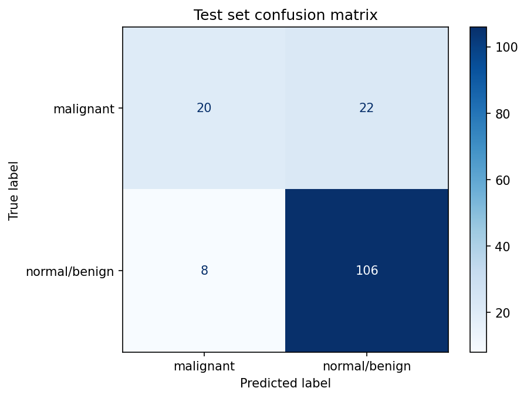
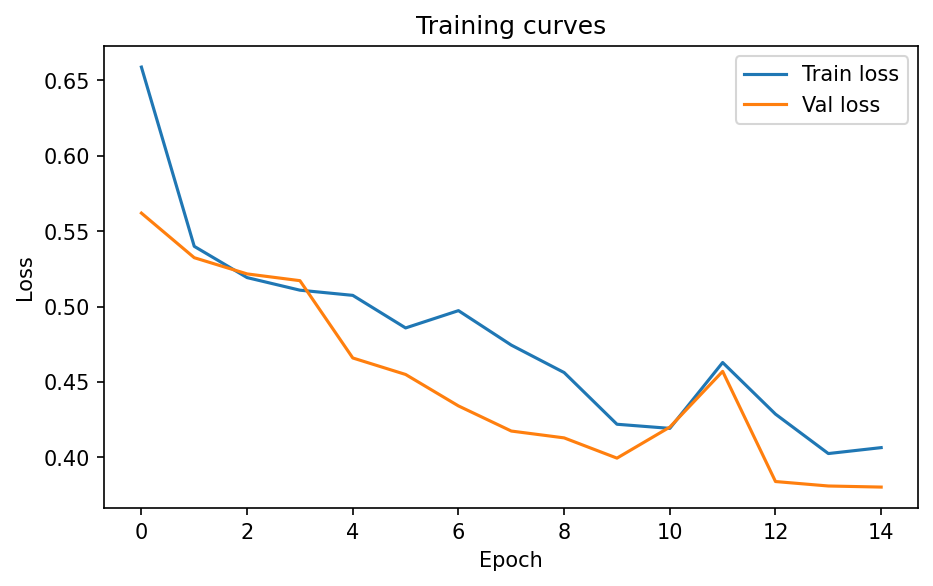

# Medical Image CNN Classifier

A convolutional neural network (CNN) built in PyTorch to classify breast ultrasound images as malignant or normal/benign.

## Dataset
- **BreastMNIST** from the MedMNIST collection, loaded at 224×224 resolution
- 546 training, 78 validation and 156 test images
- Imbalanced: normal/benign images outnumber malignant ones by about 3 to 1

## Approach
- **Preprocessing:** normalisation to [-1, 1]; random horizontal flip and small rotation (±10°) on training images only
- **Model:** a 3-block CNN (Conv → ReLU → MaxPool, with 16, 32 and 64 filters) followed by a fully connected classifier with dropout (0.5), trained from scratch
- **Training:** Adam optimiser (lr = 0.001), cross-entropy loss, 15 epochs, batch size 32, keeping the weights with the lowest validation loss
- **Tools:** Python, PyTorch, torchvision, scikit-learn, Matplotlib, Google Colab (T4 GPU)

## Results (test set, 156 images)

| Class | Precision | Recall | F1 |
|---|---|---|---|
| Malignant | 0.71 | 0.48 | 0.57 |
| Normal/benign | 0.83 | 0.93 | 0.88 |

Overall accuracy: **0.81**

## Discussion
- The model identifies normal/benign images well but detects only about half of the malignant cases.
- The class imbalance is the likely cause, since the model is biased towards the majority class. In a medical setting, missing malignant cases is the more costly error, so recall on that class is the metric that matters most.
- This is a simple baseline trained from scratch on a small dataset, so it is not suitable for clinical use.

## Next steps
- Add class weighting or oversampling to improve malignant recall
- Compare with transfer learning (e.g. ResNet18)
- Add Grad-CAM visualisations to see which image regions drive predictions

## How to run
1. Open the notebook in Google Colab and select a GPU runtime
2. Run all cells in order (the dataset downloads automatically via the `medmnist` package)
